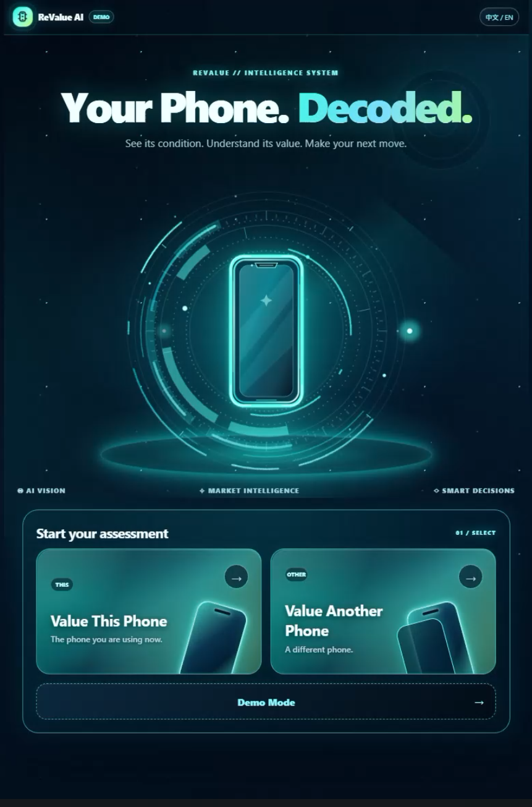
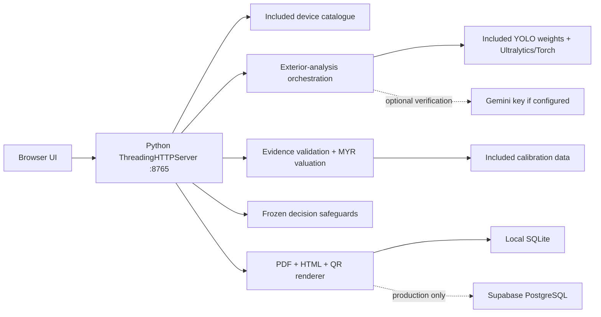

# ReValue AI — Your Phone. Decoded.

> From exterior evidence to explainable value and a confident next step.

[Live demo](https://revalue-ai.onrender.com) · [One-click Windows demo](#try-revalue-ai) · [Judge quickstart](docs/JUDGE_QUICKSTART.md) · [Architecture](docs/ARCHITECTURE.md)

  

<strong>01 — Home. Your Phone. Decoded.</strong>

ReValue AI is a device-assessment and decision-support prototype for used smartphones. It brings a guided evidence-capture flow, conservative exterior analysis, Malaysian-market valuation, explainability, and a clearly qualified recommendation into one product journey.

It makes its limits visible: market ranges are indicative rather than guaranteed offers; Demo Mode internal figures are illustrative rather than measured hardware telemetry; the IMEI tool checks format and checksum only; and shop listings are sponsored demonstration content, not verified merchant quotes.

## Try ReValue AI

### Option A — live website

Open [revalue-ai.onrender.com](https://revalue-ai.onrender.com).

### Option B — one-click local demo on Windows

1. Download this repository as a GitHub ZIP and extract it.
2. Double-click [`START_REVALUE_AI.bat`](START_REVALUE_AI.bat).
3. Wait for `Ready at http://127.0.0.1:8765`; the browser opens automatically.

The launcher creates a project-local virtual environment, installs Python packages only when `backend/requirements.txt` changes, starts the actual Python backend, waits for `/health`, and uses isolated local SQLite under `.local-run/`. It does not use Render or Supabase configuration for local operation.

**Supported launcher target:** 64-bit Windows with Python 3.10–3.13. First launch needs internet to download packages and can take several minutes because CPU PyTorch is large. Later launches reuse `.venv`. Docker, CUDA, an NVIDIA GPU, Git, a Supabase account, and a Gemini API key are not required to launch the local UI.

Use [`STOP_REVALUE_AI.bat`](STOP_REVALUE_AI.bat) to stop only the server started by this launcher. Use [`RESET_DEMO.bat`](RESET_DEMO.bat) to remove local report snapshots after confirmation. See [Judge Quickstart](docs/JUDGE_QUICKSTART.md) for exact limits and troubleshooting.

## The product journey

`SCAN → UNDERSTAND → VALUE → EXPLAIN → DECIDE → ACT`

1. **Identify** — search the included device catalogue and confirm storage.
2. **Capture** — collect five guided exterior views locally or through the optional remote-camera flow.
3. **Analyse** — run the included YOLO model when dependencies and usable photos are available; uncertain cases remain pending rather than becoming a grade.
4. **Understand** — present exterior evidence beside an explicitly illustrative internal profile in Demo Mode.
5. **Check identity** — validate a 15-digit IMEI's format and Luhn checksum, not blacklist, ownership, lock, or stolen-device status.
6. **Value** — derive an MYR market range from validated exact-device evidence.
7. **Explain** — surface evidence strength, comparable coverage, methodology, and exclusions.
8. **Decide** — tailor an action recommendation to a user goal without treating unverified trade-in figures or sample internal grades as verified evidence.
9. **Share** — export a private PDF or explicitly create a read-only report snapshot with a seven-day expiry and QR code.
10. **Act** — compare illustrative sponsored shop paths and continue in demonstration chats.

## Product gallery

The product journey moves from guided capture to an explainable result and a clear next action. These final screenshots are presentation states, not evidence of a particular real device, merchant, or market quote.

| 02 — Exterior Scan | 03 — Diagnostic Profile |
| --- | --- |
|  |  |

| 04 — AI Value Revealed | 05 — Recommended Shops |
| --- | --- |
|  |  |

  

**06 — Cosmic Chats.** Continue through an illustrative merchant conversation while keeping the assessment boundaries visible.

## Architecture

The implementation is one Python HTTP server, not a microservice estate. See [Architecture](docs/ARCHITECTURE.md) for module-level boundaries.

## Engineering integrity

- The tracked YOLO weights and loader are included. Missing weights, dependencies, or usable image evidence yield an unavailable/pending result rather than a fabricated grade.
- Gemini is optional and server-side only; no browser receives an API key.
- Valuation validates evidence for the confirmed catalogue device and keeps trade-in benchmarks and repair references separate from resale valuation. Unsupported currency and weak evidence are rejected or qualified.
- Internal scores in the demo journey are labelled as illustrative; they are not hardware telemetry.
- Shared reports are immutable snapshots with random tokens, a seven-day TTL, masked IMEI values, no-store headers, and restrictive response headers.

## Reproducibility and tests

The tracked source ZIP contains the UI, static images, device catalogue, Malaysian market calibration, YOLO weights, requirements, and tests. It does not need a Git checkout.

Run `py -3.13 backend/tests/run_backend_self_test.py`, `py -3.13 backend/tests/test_report_sharing.py`, `py -3.13 backend/tests/test_report_storage_backend.py`, `py -3.13 backend/tests/test_decision_engine.py`, and `node backend/tests/integration_hardening_frontend_test.cjs` from the repository root.

The release also provides a native-Chrome report/shops visual smoke helper when Chrome is available. Exact validation results and platform limits are recorded in the [Judge Quickstart](docs/JUDGE_QUICKSTART.md).

## Honest local limitations

- Initial dependency installation requires package-network access; a clean ZIP cannot be fully launched offline unless dependencies were staged first.
- The judge launcher is Windows-only. macOS/Linux are not claimed as supported because a portable launcher was not validated here.
- CPU inference is supported by design but may be slower than GPU. CUDA is not required.
- A localhost QR is same-computer only. Cross-device access requires a deliberately configured reachable base URL and suitable LAN security.
- Local report sharing persists in SQLite; production PostgreSQL is used only when explicitly configured.

## Project map

`app/` — product UI and static assets. `backend/` — server, evidence/valuation/decision modules, models, data, and tests. `scripts/` — safe Windows local operator workflow. `docs/` — judge guide, architecture, and real product captures.

This is a demonstrable prototype, not a merchant-verification, blacklisting, hardware-diagnostics, or guaranteed-offer service. For a competition review, start with [Judge Quickstart](docs/JUDGE_QUICKSTART.md).
